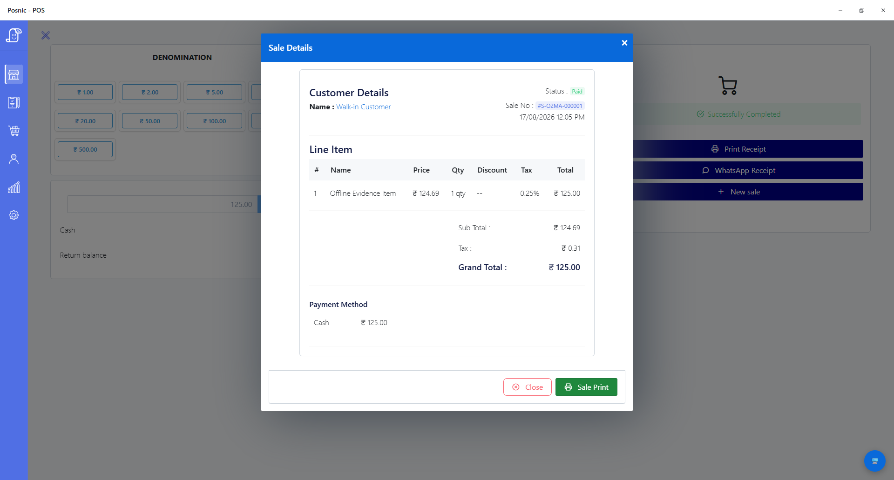

<div align="center">


# Posnic

**Free open source POS and billing software with public source, local checkout
and offline billing.**

An offline-first POS for retail shops. The primary API and database run on the
shop computer or on a server you control. Optional integrations can still need
a network.

Posnic's own source is AGPL-3.0-only. Release packages also bundle separately
licensed components, including MongoDB Community Server under SSPL-1.0. Review
the [package notices](THIRD-PARTY-NOTICES.md) and the licence material shipped
with the exact package before making a package-level licence statement.

</div>

---

## Posnic in use



This synthetic cash sale was completed and reopened during the bounded
offline workflow verification. The release notes record what was blocked, what
passed and what the result does not prove.

## Why Posnic

Posnic runs its primary database and API on the till itself. In a bounded
v1.3.0 Windows test, one synthetic cash sale completed and reopened while
external hosts were blocked inside Electron. This does not prove an
operating-system-wide outage, complete shift, payment-terminal path, power-loss
recovery or every workflow. The release notes record the evidence and its
limitations.

- **Free local edition.** The v1.3.0 desktop packages have no trial clock and
  have a zero software price. Posnic's own source is AGPL-3.0-only; packaged
  dependencies retain their own licences. Hardware, support, backups, optional
  services and downtime can still create operating costs.
- **Local data path.** The local edition needs no Posnic account, and its
  published privacy policy says it sends no analytics or telemetry to Posnic.
  See [PRIVACY.md](docs/PRIVACY.md).
- **Posnic source under AGPL-3.0-only.** Read it, change it, self-host it and
  fork it under the licence terms. Review each bundled component separately.

## Features

| | |
|---|---|
| **Selling** | Fast keyboard and touch billing, barcode scanning, returns, part payments, held bills, quick sale |
| **Stock** | Items, variants, categories, purchases, supplier returns, inventory logs, low-stock alerts |
| **Customers** | Customer accounts and contact details |
| **Hardware** | Documented paths for thermal printers, barcode scanners, cash drawers, weighing scales and second displays; verify the exact device in the [hardware matrix](docs/HARDWARE_MATRIX.md) |
| **Reports** | Sales, purchases, inventory, profit, staff activity — all exportable |
| **Branches** | Multiple outlets, per-branch stock, staff roles and permissions |

## Install

Posnic installs two ways, both free and both the same AGPL-3.0 software.
**Most shops want the desktop app.**

| | **Desktop** | **Your own server** |
|---|---|---|
| Install | Download and run | One command on Ubuntu |
| Used from | That computer | A browser on any till, tablet or phone on the network |
| Data lives | That computer | Your server |
| Needs internet | No | No — your own network is enough |
| Somebody maintains it | No | **You** — updates, backups, certificate |

A server is not a better desktop; it is a machine somebody has to look after. If
one person rings up sales on one computer, the desktop app is the right answer
and always will be. The server install does not include sync between tills or
branches; it is one database that the tills on your network use together.


### Desktop

Download the package for your platform from the repository's release page, run
it, and follow the wizard. Release packages include MongoDB Community Server under
its separate SSPL-1.0 licence, so no separate database install is needed for the
bundled setup. See [third-party notices](THIRD-PARTY-NOTICES.md).

Verify your download against `SHA256SUMS.txt`. For releases that provide an
artifact-bound SBOM and provenance, follow the [release verification guide](docs/VERIFY_RELEASE.md).

> Windows installers published by the release workflow are signed and
> timestamped, and macOS packages are signed and notarized. If the operating system reports an unknown
> publisher, stop and verify the package against the official release before
> running it. **Linux**: make the `.AppImage` executable, or install the `.deb`.

First launch takes a few minutes while it sets up its database. After that,
seconds. Full walkthrough in the **[user guide](docs/USER_GUIDE.md)**.

### Your own server

Ubuntu 24.04, 2 GB of memory, 8 GB of disk. A 2 GB virtual machine from any
provider runs a single shop comfortably.

From a source checkout:

```bash
less scripts/install-server.sh   # read it first - you are about to run it as root
sudo env POSNIC_REPO="$PWD" POSNIC_BRANCH="$(git branch --show-current)" bash scripts/install-server.sh
```

It installs Node.js 22, MongoDB 8 and Posnic into `/opt/posnic`, generates that
machine's own secrets, and runs it under systemd so it survives a reboot. When
it finishes it prints the address to open. Re-running it updates Posnic and
leaves your secrets and your data alone.

Three things it cannot do for you, none of them optional on a shop taking real
money: **get a certificate** (without one, passwords cross the network in the
clear), **keep port 27017 off the internet**, and **restore a backup once** to
prove it is a backup rather than a file.

A self-hosted Posnic is one database several people use at once — which is what
most single-shop setups actually want.

Full guide, including installing by hand on other systems:
**[docs/SELF_HOSTING.md](docs/SELF_HOSTING.md)**.

## Build from source

```bash
git clone <repository-url> POS
cd POS
npm install
npm --prefix api install
npm start
```

Needs Node 22.12+. The build tooling fetches MongoDB Community Server 7.0.14 and
the desktop process chooses a port derived from the app name to reduce collision
risk. Review [the architecture](docs/ARCHITECTURE.md) and package licences before
building or distributing an artifact.

```bash
npm run build          # Windows installer
npm run build:mac
npm run build:linux
```

The Linux AppImage is written to
`dist/Posnic-<version>-linux-x86_64.AppImage`. Upload it as a release asset
rather than adding it to git: the release host rejects files over 100 MB.

New contributors should start with the
**[contributor quickstart](docs/CONTRIBUTOR_QUICKSTART.md)**. See the
**[developer guide](docs/DEVELOPMENT.md)** for deeper tests, linting and
conventions.

## Editions

The desktop packages have a zero software price and no trial clock. Posnic's own
source is AGPL-3.0-only, while bundled components keep their separate licences.

The desktop app and the self-hosted server are the same software. Neither is a
trial and neither expires. What is free today stays free; this is written down
in [GOVERNANCE.md](docs/GOVERNANCE.md).

## Documentation

| | |
|---|---|
| [User guide](docs/USER_GUIDE.md) | Running a shop with Posnic, first sale to closing the till |
| [Contributor quickstart](docs/CONTRIBUTOR_QUICKSTART.md) | Local setup, test commands, issue map, PR flow and safety rules |
| [Developer guide](docs/DEVELOPMENT.md) | Setup, tests, conventions, good first issues |
| [Architecture](docs/ARCHITECTURE.md) | How it fits together, and the parts that bite |
| [REST API](docs/API.md) | 572 endpoints, generated from the routes |
| [Hardware](docs/HARDWARE_MATRIX.md) | Printers, scanners, drawers, scales — and how far each claim is checked |
| [Backups](docs/BACKUP_POLICY.md) | What is backed up, when, and what it does not protect you from |
| [Disaster recovery](docs/DISASTER_RECOVERY.md) | Getting back to working, with RPO and RTO as numbers |
| [Release runbook](docs/RELEASE_RUNBOOK.md) | How a release goes out, and four ways to take one back |
| [Release verification](docs/VERIFY_RELEASE.md) | Match a package to its checksum, CycloneDX inventory, provenance and component licences |
| [Support lifecycle](docs/SUPPORT_LIFECYCLE.md) | Which versions get fixes, and for how long |
| [Incident response](docs/INCIDENT_RESPONSE.md) | Who decides, who is told, and when |
| [Contributing](.github/CONTRIBUTING.md) | How to get a change merged |
| [Public roadmap](docs/ROADMAP.md) | Current priorities, evidence gaps and structured ways to help |
| [Citation metadata](CITATION.cff) | Human and tool-readable citation identity for exact releases or commits |
| [Adoption evidence](docs/ADOPTION_EVIDENCE.md) | How real deployment reports are scoped, reviewed, cited, corrected and kept privacy-safe |
| [Support](.github/SUPPORT.md) | Where to ask, and what happens to your issue |
| [Governance](docs/GOVERNANCE.md) | Who decides what, and what we have promised |
| [Privacy](docs/PRIVACY.md) | What the app collects, and what it does not |
| [Security](.github/SECURITY.md) | What Posnic protects, what it cannot, and reporting a vulnerability |
| [Third-party notices](THIRD-PARTY-NOTICES.md) | Separately licensed software included in release packages |
| [CodeMeta](codemeta.json) | Machine-readable product, publisher, source, licence and platform identity |
| [Code of conduct](.github/CODE_OF_CONDUCT.md) | How we treat each other |

## Contributing

Bug reports, fixes, translations, hardware quirks from real shops, documentation
— all welcome, and none of it requires permission to start. The
[contributor quickstart](docs/CONTRIBUTOR_QUICKSTART.md) gives the local setup,
test commands and public feature-ticket map.

Good places to begin are listed in the
[developer guide](docs/DEVELOPMENT.md#good-first-issues): 19 known-failing tests,
21 real latent bugs the linter found, and two very large files that want
splitting.

Read [CONTRIBUTING.md](.github/CONTRIBUTING.md) first. Security issues go to
[SECURITY.md](.github/SECURITY.md), privately — never a public issue.

### For businesses

**Posnic Innovations**, Tamil Nadu, India.

| | |
|---|---|
| Sales and licensing | Your distributor or maintainer |
| Support | [SUPPORT.md](.github/SUPPORT.md) |
| Security | The private contact supplied with your distribution — never a public issue ([SECURITY.md](.github/SECURITY.md)) |

Paid setup, migration from an existing till, hardware selection, custom
reporting and white-labelled installers are all available. The software stays
free either way — see [GOVERNANCE.md](docs/GOVERNANCE.md) for what we have promised
never to move behind a paywall.

## Source and package licences

Posnic's own source is [GNU AGPL-3.0-only](LICENSE). Use, change, self-host and
redistribute that source under the licence terms. Release packages also include
separately licensed components; read [THIRD-PARTY-NOTICES.md](THIRD-PARTY-NOTICES.md)
and the licence material shipped with the exact artifact. This summary is not
legal advice.

The **Posnic name and logo are trademarks** and are not covered by the AGPL —
see [GOVERNANCE.md § Trademark](docs/GOVERNANCE.md#trademark-and-reserved-rights).

Companies needing to keep modifications private can buy a commercial licence:
**your distributor or maintainer**. Such a licence covers the code Posnic owns. Contributors
keep the copyright in what they write and there is no CLA, so community code can
only be relicensed with its author's agreement — a deliberate limit on our own
power, set out in [GOVERNANCE.md § Contributor
copyright](docs/GOVERNANCE.md#contributor-copyright).
